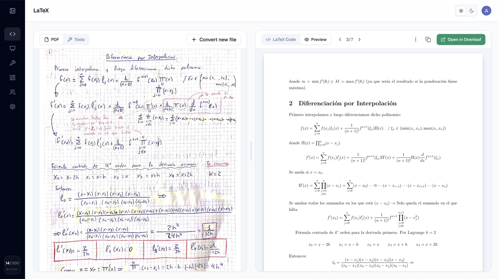
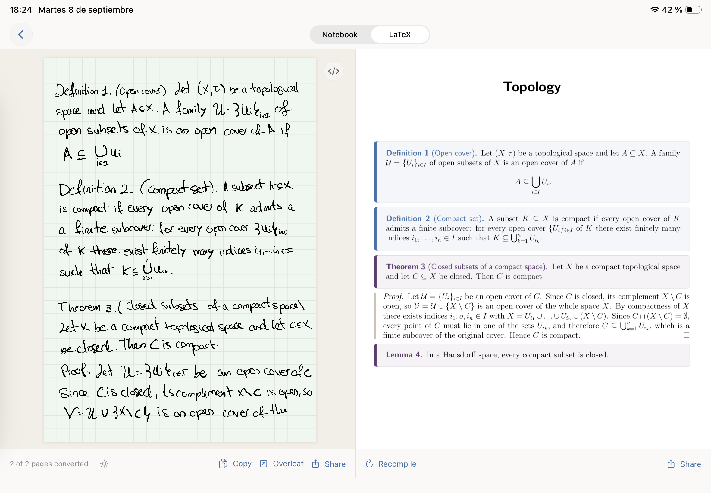
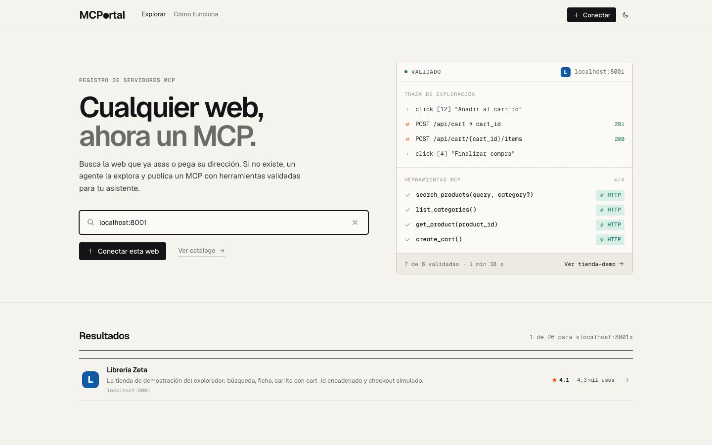

# Andrés Osorio Leyenda

**Founder | Math & CS Student**

**Best at:** TypeScript, Next.js, React, AI/LLM integrations, MCP integrations, Supabase. Product Engineering.

**Familiar with:** C, Python, Java, Swift, Node.js.

**Other skills:** Funnels, organic marketing, A/B testing, customer support, business planning...

---

## TL;DR

I'm a solo founder from Santiago de Compostela who loves to build things people actually use.

I founded **MathWrite** and **MathWrite Notes**, a suite of tools around LaTeX (**40k+ users and $3–4k/month in revenue**), while studying Math & CS at uni.

## About Andrés

I'm a student with the heart of a founder, and I've always combined both.

Currently, I'm in my 5th year at university, putting all my effort into MathWrite and MathWrite Notes. I make all the decisions, handle development, customer support, marketing...

I'm really agent-driven and keen on automating every process I can across my products. I also have a lot of expertise in organic marketing for growth.

I build in public on [X](https://x.com/deandre_leyend) and share my wins and losses there.

## Main Achievements

- **MathWrite – Solo Founder (February 2025)**  
  30k+ users and $1k MRR.  
  Paying users from top universities worldwide.

  

  

- **MathWrite Notes – Solo Founder (September 2026)**  
  +5k downloads since launch and doing $2–3k/month in sales.
  

  

- **MCPortal – 1st Place, GDG Santiago Hackathon (October 2026)**  
  Built an MCP server generator that turns any website or internal tool into an MCP server using Playwright.
  

  

- Gave my first talk at Google Developer Groups Santiago.

## Most Prideful Builds

| Project | Role & Stack | Why it matters |
|---|---|---|
| **MathWrite** | Solo Founder · TypeScript, React, Next.js, Supabase, Prisma | Saves countless hours for the academic community by converting handwriting to LaTeX. |
| **MathWrite Notes** | Solo Founder · Swift | Enables instant LaTeX note-taking on iPads. |
| **MCPortal** | Python, Playwright, MCP | 1st place at the GDG Santiago Hackathon. Enables the creation of MCP servers using only a website URL. |

**More builds:** Internal tools for automating organic content creation and distribution.

## Experience (TL;DR)

- **MathWrite (February 2025 – Present)** – Solo Founder
- **MathWrite Notes (September 2026 – Present)** – Solo Founder
- **5th year of Math + CS at USC**
- Active in local community events and starting out as a speaker.

## How I Work

**Gets me pumped:** Building something people use, hearing first-hand user feedback, shipping and iterating fast.

**Disappoints me:** Big corporations, boomers underestimating the new generation, slow teams...

**Strengths:** Generalist, technical skills + funnels, marketing, A/B testing, customer interaction, metrics optimization...

**Improvement points:** Not a lot of experience working in teams. I tend to be quite independent, and maybe a little too eager to ship too fast sometimes.

**Known behaviours:** Highly proactive, comfortable with uncertainty, eager to help.

## Why I'm a Good Fit

I have the expertise to build a small product on my own. I'm really eager to learn from smarter people and in a team environment, which I think will have a massive impact on my personal development and help me build better and bigger ideas in the near future.

## Other

### Some Personal Stuff

- Born in Santiago de Compostela (2004).
- Did Erasmus in Cluj-Napoca (Romania). I enjoy multicultural environments.
- C1 English level.
- Played for the Galicia Basketball Selection Team for 6 years.
- Libertarian view of the internet.

## My Vision

Regarding MathWrite, I want to turn it into the default note-taking app for STEM students and collaborate with as many universities as possible.

In the next few years, I want to learn from the best teams, build a solid network, and drive bigger and more ambitious projects that can have a great impact on the world.
